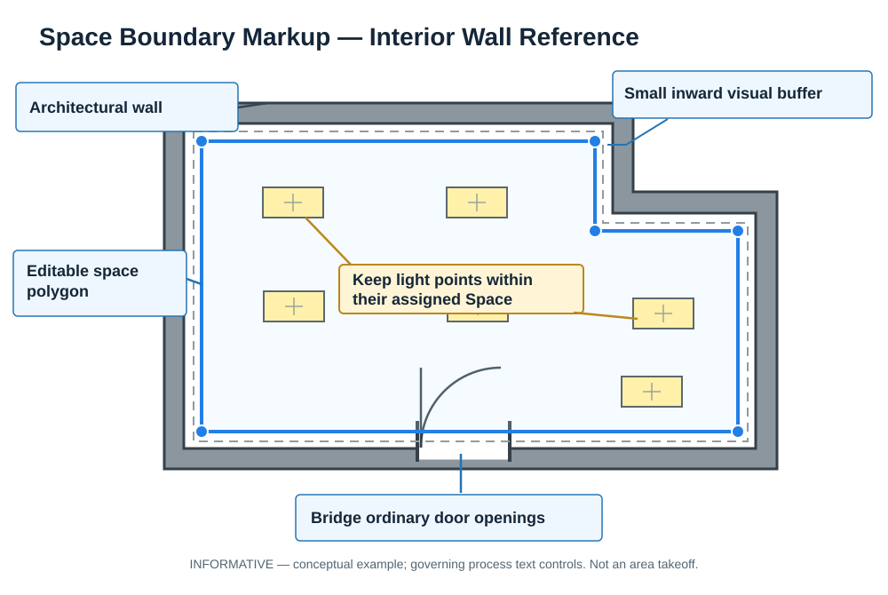
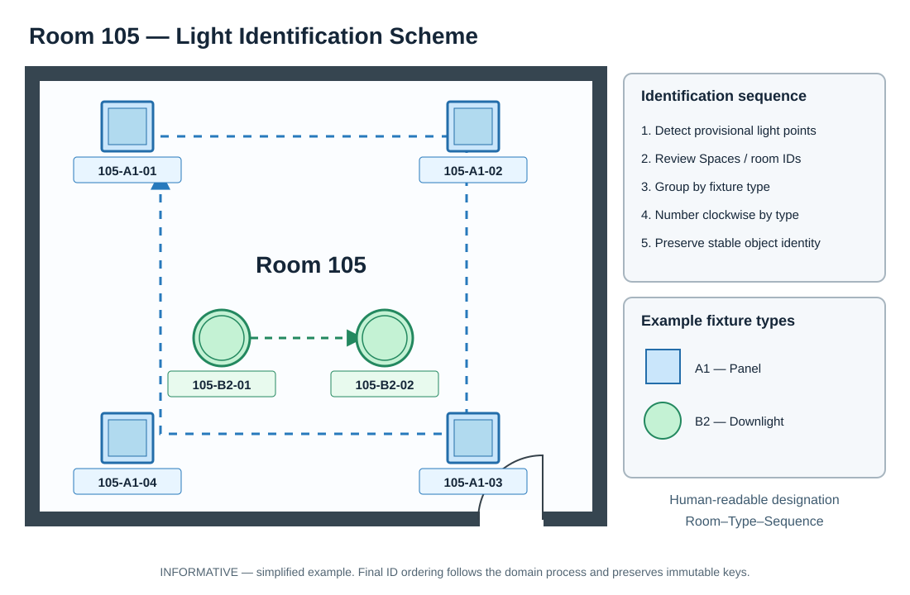

# KIS Engineering Illustrations (Informative)

Illustrations in this directory are **non-normative** engineering education and onboarding aids, similar in authority to explanatory illustrations in the NEC Handbook. They do not add requirements or override an approved process, data contract, source drawing, or engineering decision. The governing written process/specification controls if interpretation differs.

## Space Boundary Markup

**Purpose:** Illustrate a small inward visual buffer from the room-side finished wall face, editable polygon vertices, ordinary doorway bridging, and preliminary light point containment. A visual buffer is **not** a reduction in the engineering area of a space. It must not redefine the architectural room boundary or override accepted owner-returned geometry. The source geometry and code-relevant area convention remain distinct.

**Related guidance:** [LV Architectural Space Intake](https://github.com/kissolutions/lv-lighting-design/blob/main/docs/design-playbooks/architectural-space-intake.md) and KIS [Physical Boundary Intake](../../design-playbooks/physical-boundary-intake-v0.1.md). The illustrated Space polygon is not itself a Physical Boundary Register entry.

## Clockwise Light Object IDs

**Purpose:** Explain the proposed human-readable `Room–FixtureType–Sequence` convention. Preliminary Light Point Extraction records observed points without assigning final fixture IDs. Later, after Space association and fixture type reconciliation, the system numbers lights of each type clockwise around a room, keeping immutable internal identity and original source references separate from readable labels. Irregular rooms, fixture assemblies and ID stability require the governing domain process; this diagram is not a universal geometric ordering algorithm.

**Related guidance:** KIS [Engineering Architecture Contract](../../governance-and-doctrine/systems-engineering-framework-v1.md) and [LV Lighting workflow](https://github.com/kissolutions/lv-lighting-design/blob/main/docs/design-playbooks/lv-project-workflow-and-readiness.md).

## Maintenance conventions

- Mark diagrams **INFORMATIVE**, **Training**, or **Conceptual Example**; never present as design approval or code source.
- Keep each diagram near the named process/schema it explains, with links in both directions when useful.
- Review diagrams when underlying process/schema conventions change.
- Drawn names, fixture counts, room geometry, scales and products are explanatory placeholders unless a real project source is cited explicitly.

**Format:** SVG is the repository-native image format here: scalable, diffable, and directly rendered by Markdown/GitHub. These are faithful conceptual vector renditions of the two figures developed during the M1 discussion, rather than binary copies of the originally generated PNGs.
