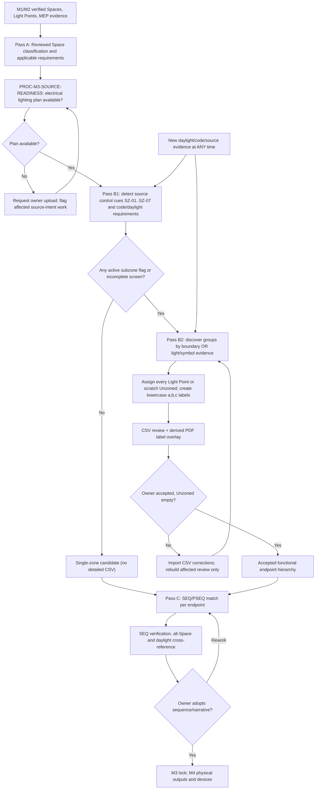

# M3 Lighting Controls Sequence Lifecycle v0.1

**Phase 2 — Design Basis & Requirements; Milestone M3 — Controls Narrative and Sequence Assignment.**
This lifecycle instantiates the shared KIS phase/process/milestone distinctions. It is a design-basis review cycle, not automatic approval of new control design or a requirement to implement physical sensor placements at M3.

## M3 source document readiness — required before functional zone discovery

**PROC-M3-SOURCE-READINESS v0.1** checks the project source register and currently available drawings **before extracting/reconciling original MEP control groups and functional subzones**.

1. **Electrical lighting plan availability**: `available`, `missing`, or `unverified`. Record document ID, drawing sheet(s), revision and source location when available. If missing/unverified, request that the owner upload the applicable electrical lighting plan; retain a `source_document_missing` finding until addressed. Do not claim MEP circuit/switch intent was reviewed without it. This is a targeted owner request, not a reason to stop unrelated classification or M1/M2 intake.
2. **Controls-evidence completeness** (independent status): `not_reviewed`, `complete`, `partial`, or `ambiguous`. A present plan passes the **availability** gate even when control details are incomplete; inspect fixture switching letters/group notation, circuit/home-run markings, wall-switch/dimmer symbols and tags, sensor/control legends, keyed notes, schedules and referenced details to determine source intent. An electrical branch circuit is **not automatically** one independently switched/dimmed lighting group.
3. **Related documents**: Check fixture schedule, architectural/accepted room footprint evidence, window/glazing/elevation data as required by daylight-zone geometric derivation, and referenced controls specifications/details. Request a missing source **only if needed to resolve a specific requirement**; do not require a full architectural package where an accepted room register and electrical lighting plan supply sufficient evidence.
4. **Current single-plan scenario**: When the owner provides **only the electrical lighting plan**, mark `lighting_plan_available=available` and move to evidence extraction. Preserve unresolved fixture-schedule, circuiting, switch/group association, daylight geometry or code-basis questions as targeted findings—**do not hold the availability gate open or invent missing plans**.
5. **Pass-order**: classified Space/requirements -> source-readiness check -> source controls and daylight/functional-zone discovery -> endpoint sequence matching -> all-Space review/owner lock. If functional zoning cannot be established from the plan, return only the affected zones to source review; no global restart is required.

**Work product:** M3 Source Readiness Record (source ID/revision, `lighting_plan_available`, `source_control_intent_status`, observed symbols/circuit/group evidence, separately missing inputs, owner request and affected-Space/Light Point IDs). It is a review process contract; no unsupported project schema properties are implied.

## Flow

**Reusable sub-process:** [Lighting Subzone Detection and Extraction v0.1](lighting-subzone-detection-extraction-v0.1.md). Both geometry/requirements-first and fixture/switch-first discovery feed the same owner-reviewed CSV and zone hierarchy; no order dependency. A late daylight area reopens only affected Spaces and invalidates affected sequence assignments until re-verification. Unknown/Unzoned fixture membership must **never** enter an accepted endpoint sequence.

## Stable M3 processes and work products

| Process ID | Primary input | Work product and invariant |
|---|---|---|
| `PROC-M3-CLASSIFY v0.1` | Architectural facts, actual use, occupied level, M1 Space register | Candidate **independent** Building Code Space Type, Building Code Occupancy Group, and Energy Code Space Type; owner confirmation or unknown |
| `PROC-M3-REQUIREMENTS v0.1` | Reviewed classifications, selected code edition/path/jurisdiction, amendments, area/enclosure, daylight evidence | Applicable requirements and exceptions matrix with exact source locators; unknown applicability remains open |
| `PROC-M3-SUBZONE-DETECT v0.1` | Reviewed Space, source plan and code/daylight evidence | SZ-01..SZ-07 evidence flags, confidence report below HIGH and single-zone fast-path eligibility |\n| `PROC-M3-SUBZONE-EXTRACT v0.1` | Flagged Spaces, Light Points, daylight areas | Iterative CSV owner review, scratch Unzoned exclusion, additive PDF labels and accepted parent/leaf structure |\n| `PROC-M3-SOURCE-CONTROLS v0.1` | M2 drawings, notes, symbols, schedules, existing sequences | By-function source observations and compliant/deficient/ambiguous/no-information/not-reviewed findings; never overwrite source intent |
| `PROC-M3-SEQ-MATCH v0.1` | Requirements, documented source functions, code profile, approved [SEQ Registry](lighting-control-standard-sequences.md) | Ranked candidates with applicability, revision, verified coverage and conflicts; never auto-select reserved draft entries |
| `PROC-M3-SEQ-AUTHOR v0.1` | Missing fit and explicit owner scope/authorization | Project-owned `PSEQ-###` narrative draft, parameters, evidence and unresolved issues; no silent promotion to standard |
| `PROC-M3-SEQ-VERIFY v0.1` | Proposed SEQ/PSEQ, adopted source, requirements | Per-function behavioral and code-applicability comparison, source-intent conflict finding, documented limitations |
| `PROC-M3-ZONE-ASSIGN v0.1` | Accepted or reviewed functional endpoint structure from B2 | Sequence assignment to each endpoint/leaf with exact ID + revision and any parameters/owner overrides. **Never assign SEQ before zone membership reconciliation; parents have none.** |
| `PROC-M3-CROSS-REFERENCE v0.1` | Spaces, Light Points, proposed zones/sequences, daylight determinations | All-Space narrative/fixture coverage review, lightless/service exceptions, missing-direction findings, M4/M5 deferrals |

A process may repeat for a subset of the project; do not multiply owner approval requests for each internal iteration. Confirming classification, authorizing gap filling, accepting an interpretation, and adopting a sequence are **distinct** owner decisions. Use one consolidated M3 review package after incremental issue resolution.

**Sequence dimming semantics:** Each proposed endpoint sequence explicitly declares `dimming_scheme` (`continuous`, `stepped`, `none`, or unresolved `unknown`) and required step count for stepped operation. Keep that behavior separate from the fixture's physical dimming interface; only M4 device selection resolves actual dimmer/controller output compatibility. See the [shared dimming vocabulary](../ontology/lighting-dimming-vocabulary-v0.1.md).

## Governing constraints

1. **Source vs requirement vs design proposal:** Preserve MEP source intent even when it differs from KIS preference. An existing design cannot be replaced merely because a library sequence looks attractive. Require scoped redesign authority and a separately approved result.
2. **Standard eligibility:** `SEQ-###` denotes KIS framework-managed standard identity; only approved revisions are valid standard selections. `PSEQ-###` is project-scoped and must be reviewed before adoption.
3. **Zone hierarchy:** A parent is only a container/coordination/aggregation node; it owns no direct luminaire assignments or physical outputs and receives **no `sequence_id`**. Every endpoint/leaf zone with accepted M3 direction references exactly one sequence identity/revision. A whole-room zone without children is a leaf. Daylight conditions can overlap occupancy leaves and remain independently traceable rather than being forced into one nesting hierarchy.
4. **Geometry vs requirements:** At M3 establish only functionally necessary zone splits and their rationale, such as an applicable open-office independent-control-area upper bound, shared aggregate conditions or daylight partitions. M4 establishes practical boundaries/device positions and verifies coverage. Do not infer physical sensor counts from zone counts.
5. **Narrative sufficiency:** Distinguish manual on/off, automatic activation, vacancy timeout/reduction, daylight, scheduling, light reduction, emergency/normal interaction, functional grouping and parameter uncertainty. Owner-level trigger, resulting state and control method are enough where later setpoints/timing detail is expressly deferred.
6. **Review coverage:** Every Space has explicit daylight determination (`yes/no/unresolved` with evidence), and every lit Space has a traced control direction. Any unlit Space is explicitly reconciled as intentionally unlit, served by another Space, missing source light data, or unresolved.
7. **Acceptance:** Issue one complete narrative per sequence ID and revision, followed by every assigned room/leaf and per-assignment variation/exception. Owner-approved lock applies only to the identified scope/revision and does not certify deferred field details or compliance beyond verified provisions.

**Mandatory post-selection validation:** Invoke [PROC-SEQ-VALIDATE v0.1](sequence-validation-process-v0.1.md) on every SEQ/PSEQ assignment build after Pass C selection and before final owner acceptance. Trigger it again on demand for code-edition, permitting-date, amendments, jurisdiction, Space classification, daylight and source-intent changes. It produces an independent revisioned work product and parameter proposals/findings; it must not silently change the sequence library, canonical model or historic acceptance. The 2021/2024 rule starter catalog is research draft; unresolved evidence cannot claim qualification.

## M3 acceptance gate

Release when: classification and code applicability are sufficiently supported; every applicable source-control function is recorded and compared; authorized sequence decisions are accepted; all leaf assignments and aggregate interfaces are traceable; daylight and all-Space fixture cross-reference is complete; consequential source/service conflicts are resolved; and acceptable M4/M5 deferrals have specific owners/scope. Otherwise retain an identified provisional M3 package, and continue unaffected work.

**Implementation note:** This describes the required process. The existing LV v0.7 model does not implement endpoint sequence references or a full code matcher; the LV extension will adopt a separately versioned companion contract and test it without falsely altering older project models.

**Owner:** KIS Solutions; 2026-10-17; v0.1.
